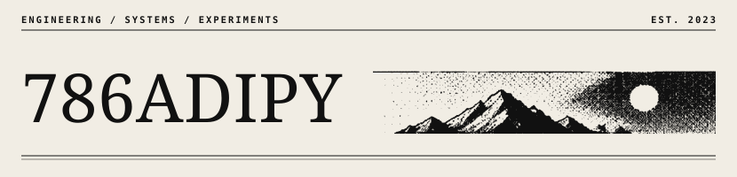
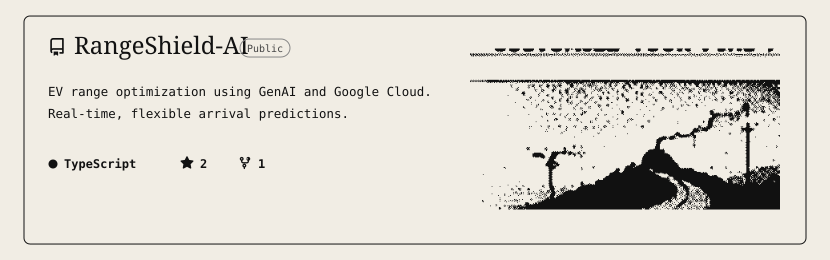
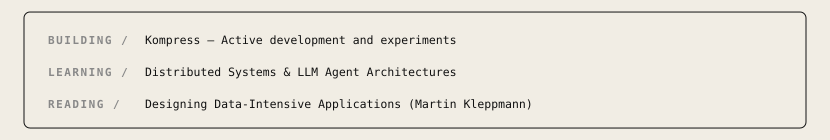
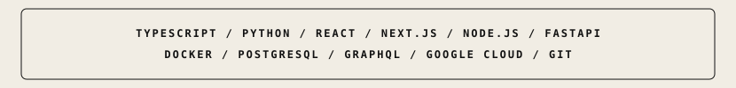
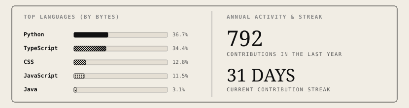

<picture>
  <source media="(prefers-color-scheme: dark)" srcset="https://raw.githubusercontent.com/786AdiPY/786AdiPY/main/assets/banner-dark.svg">
  
</picture>

  <strong>ADITHYA A M</strong> · <code>@786AdiPY</code> · <strong>TECH ENTHUSIAST</strong> 
  <code>/ Full-Stack Developer</code> &nbsp; <code>/ AI Engineer</code> &nbsp; <code>/ Systems &amp; Security</code>

---

### ■ FEATURED

<a href="https://github.com/786AdiPY/RangeShield-AI">
  <picture>
    <source media="(prefers-color-scheme: dark)" srcset="https://raw.githubusercontent.com/786AdiPY/786AdiPY/main/assets/featured-dark.svg">
    
  </picture>
</a>

---

### ■ NOW

<picture>
  <source media="(prefers-color-scheme: dark)" srcset="https://raw.githubusercontent.com/786AdiPY/786AdiPY/main/assets/now-dark.svg">
  
</picture>

---

### ■ STACK

<picture>
  <source media="(prefers-color-scheme: dark)" srcset="https://raw.githubusercontent.com/786AdiPY/786AdiPY/main/assets/stack-dark.svg">
  
</picture>

---

### ■ STATS

<picture>
  <source media="(prefers-color-scheme: dark)" srcset="https://raw.githubusercontent.com/786AdiPY/786AdiPY/main/assets/stats-dark.svg">
  
</picture>

---

  <a href="https://linkedin.com/in/adithya-am-adi"><code>LinkedIn: in/adithya-am-adi</code></a> &nbsp;·&nbsp;
  <a href="mailto:adithya@example.com"><code>Email: adithya@example.com</code></a> &nbsp;·&nbsp;
  <a href="https://adithya.dev"><code>Portfolio: adithya.dev</code></a>

