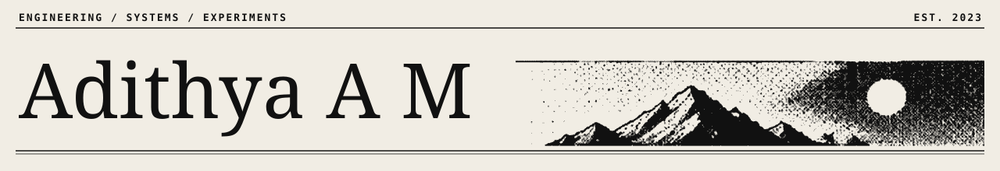
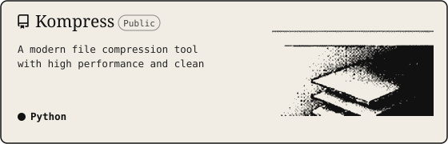
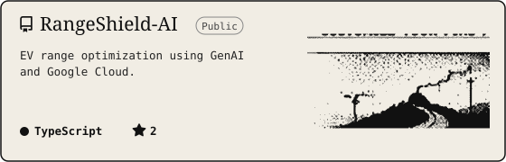
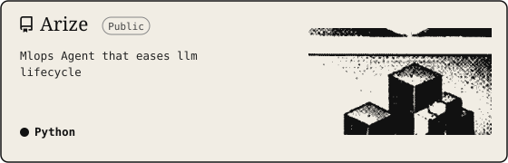
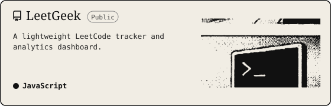
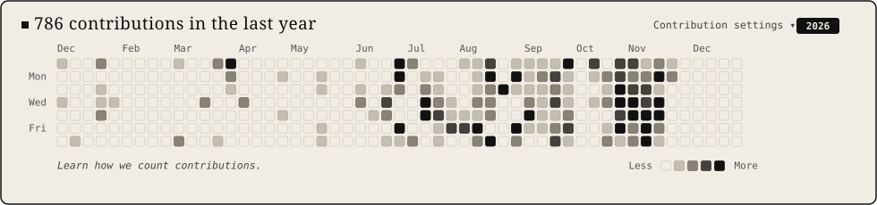
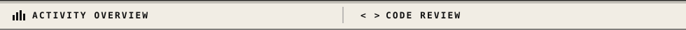

<!-- Retro Newsprint / Halftone Profile - 786AdiPY -->

  

 

<!-- PINNED SECTION -->
<table width="100%" border="0" cellspacing="0" cellpadding="0">
  <tr>
    <td align="left">
      <strong>■ PINNED</strong>
    </td>
    <td align="right">
      <code>CUSTOMIZE YOUR PINS ↗</code>
    </td>
  </tr>
</table>

<table width="100%" border="0" cellspacing="8" cellpadding="0">
  <tr>
    <td width="50%" valign="top">
      
    </td>
    <td width="50%" valign="top">
      
    </td>
  </tr>
  <tr>
    <td width="50%" valign="top">
      
    </td>
    <td width="50%" valign="top">
      
    </td>
  </tr>
</table>

 

<!-- CONTRIBUTIONS SECTION -->

  

 

<!-- FOOTER DIVIDER -->

  

